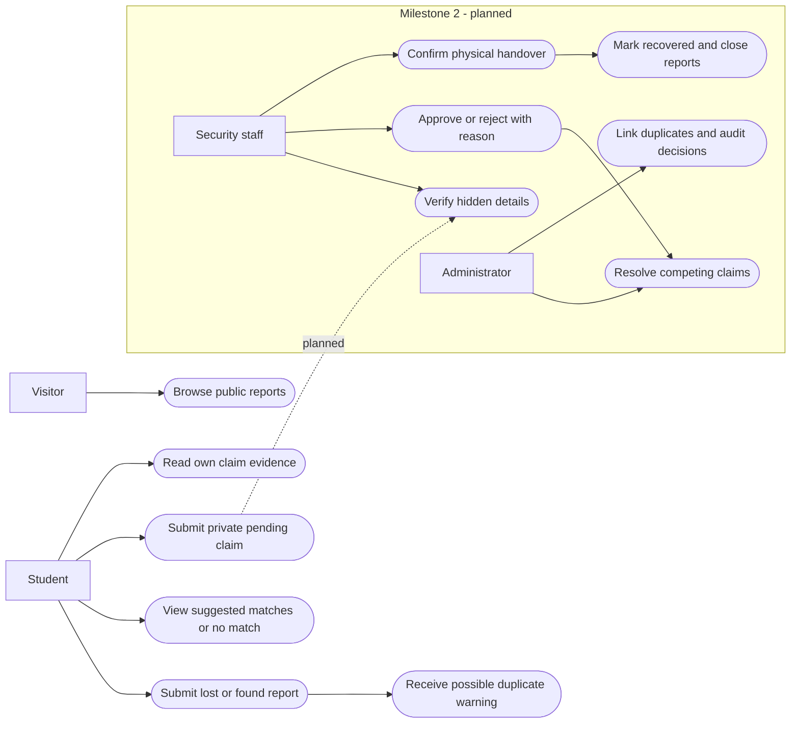
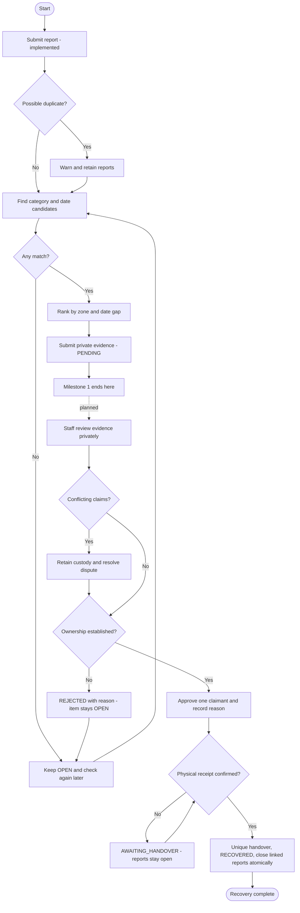
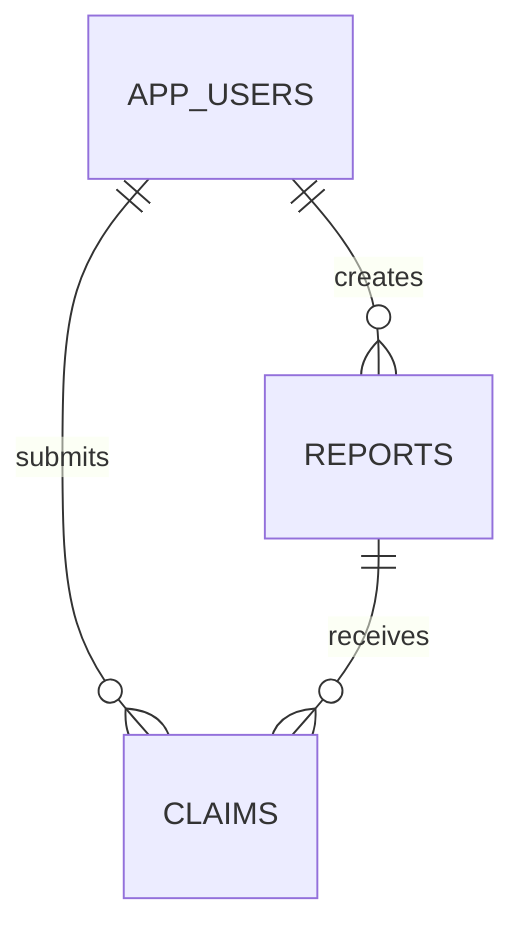

# Project design and review notes

## Milestone boundary

Milestone 1 implements reports, suggested matches, duplicate warnings, student login, private text evidence and competing PENDING claims. Milestone 2 will add staff verification, recorded decisions, disputes and physical handover. The future workflow below is a design, not an implemented feature.

## Matching — implemented

Candidates must be OPEN reports of the opposite type with exactly the same category. The found date must be 0–14 calendar days after the loss date. Ranking points:

- Same category: 50 (required).
- Same named campus zone: 25. OTHER is unspecified and earns no bonus.
- Date gap 0–1 days: 25; 2–7 days: 15; 8–14 days: 5.

Different zones remain candidates because an item may move. There is no proximity map or machine learning. Scores are ranking points, not confidence percentages. Suggestions never verify ownership or change statuses. No match leaves the report OPEN.

A possible duplicate has the same type, category, zone and case-insensitive trimmed title, with dates within one day. The creation response warns and retains both reports. Staff linking and duplicate closure are planned.

## Privacy

Public fields: general description, category, campus zone, date, report ID and status. Students are instructed to withhold contents, serial numbers, unique marks and contact information. Automatic redaction is not implemented; students must follow the form guidance.

Private fields: password hashes and claim evidence. A student can read only their own claims; public DTOs never include evidence. The current app has no staff evidence-view endpoint and no upload endpoint. Future staff access needs role checks and audit records. Future attachments need private storage and size/type validation; never put evidence into the static directory.

## Permissions

| Actor | Implemented | Planned |
| --- | --- | --- |
| Visitor | Browse general details; register/sign in | No private data access |
| Student | Submit reports, retrieve own matches, submit/read own private pending claims | Withdraw a claim; read own decision reasons |
| Security | No staff role/interface yet | Record custody, review evidence, record decisions/reasons, confirm handover |
| Administrator | No admin role/interface yet | Provision staff, resolve disputes, link duplicates, inspect audit history |

Every registered account receives STUDENT authority. Registration rejects unknown fields, including role injection. Staff provisioning must be a trusted process in the next milestone.

## Status model

Implemented: report OPEN; claim PENDING. A claim does not close or recover the report. The database prevents a student from claiming the same report twice, including concurrent submissions. Different students can each have a pending claim.

Planned:

- Claim: PENDING → UNDER_REVIEW → APPROVED or REJECTED; APPROVED → HANDED_OVER after physical collection.
- Item: OPEN → AWAITING_HANDOVER after approval → RECOVERED after confirmed receipt.
- Linked lost/found reports close only after recovery. Duplicate reports are linked with history preserved.
- Approval revocation requires a recorded reason and renewed review.

APPROVED authorises collection; it does not establish completed recovery. A handover record must contain the item, claimant, staff actor, timestamp and confirmation of physical receipt.

## Competing claims and handover — planned

1. Evaluate each claimant independently using non-public details. Do not allocate by submission order or show another claimant's evidence.
2. If evidence conflicts or remains inconclusive, retain custody and escalate to an administrator. Record why a decision is deferred.
3. Approve at most one claimant for a canonical physical item. Record approval/rejection reason, actor and timestamp.
4. At collection, re-check the approved claim and identity, then confirm physical receipt. One transaction creates the handover, marks recovery and closes linked reports.
5. Link duplicate found reports to a canonical item before release. Lock that item during approval/handover and enforce one approved claimant and one handover with database constraints. Separate report IDs must never permit a second release of one physical item.
6. Resolve other claims with recorded reasons after recovery, without disclosing the successful claimant's personal details.

These staff actions and constraints are not implemented yet. There is no approve, recover or handover endpoint in milestone 1.

## Use-case overview

An additional [PlantUML source](use-case.puml) uses UML actor/use-case notation.

## Activity diagram

## Review demonstration

Working milestone 1 demonstration:

1. With seed data enabled, register Alice. Report a LOST black backpack in BAGS at LIBRARY. Use a date on or before the sample FOUND backpack date and within 14 days.
2. Select My reports → Find matches. Explain the ranking. Add a report in a category without an opposite report to demonstrate no match.
3. Claim the sample found backpack with private details. Show PENDING and an OPEN report. A second claim by Alice fails.
4. Sign out, register Bob and submit a different claim for the same item. Both claims remain pending. Each student sees only their own evidence.
5. Submit an identical report to demonstrate the duplicate warning and retained reports.
6. Explain that staff decisions and handover are the next milestone, with no fake approval or recovery action.

Next-review target after milestone 2: Alice correctly identifies a hidden green notebook and violet stitching; Bob gives inconsistent details. Security records Bob's rejection reason and Alice's approval reason. The reports remain open before collection. On confirmed physical receipt, record one handover, mark RECOVERED and close linked reports. Retry handover, including through a duplicate report, and demonstrate rejection of a second release.

The complete verification/handover demonstration requested by the teacher is an acceptance target for milestone 2, not a working milestone 1 feature.

## Tests

Automated coverage in this milestone:

- Category, zone and date ranking; 14-day boundary; unspecified zones.
- No matches for incompatible categories/types, reversed dates or gaps over 14 days.
- Duplicate warnings with retained reports.
- Competing claims, repeated claims, claims remaining pending and reports remaining open.
- Own-item and lost-report claim restrictions.
- Evidence omitted from public reports and isolated between users.
- Report-owner match access, session login, anonymous access restrictions and CSRF.
- Password hashing, role injection rejection, future dates and missing evidence.

Milestone 2 acceptance tests, not implemented:

| Scenario | Expected |
| --- | --- |
| Incorrect hidden details | REJECTED, reason recorded, item retained |
| Two plausible claimants | Hold item until authorised dispute resolution |
| Concurrent approvals | At most one approved claimant per canonical item |
| Approved but not collected | AWAITING_HANDOVER; linked reports stay open |
| Confirmed receipt | One handover; recovered item; closed reports in one transaction |
| Repeated/concurrent release | Second handover rejected |
| Separate duplicate report | Same canonical item prevents another release |
| Student accesses staff evidence | Access denied |
| Missing decision reason | Decision rejected by validation |

## Data model

Future migrations add canonical items, report links, staff roles, decisions and handovers. Never edit an already applied Flyway migration.
